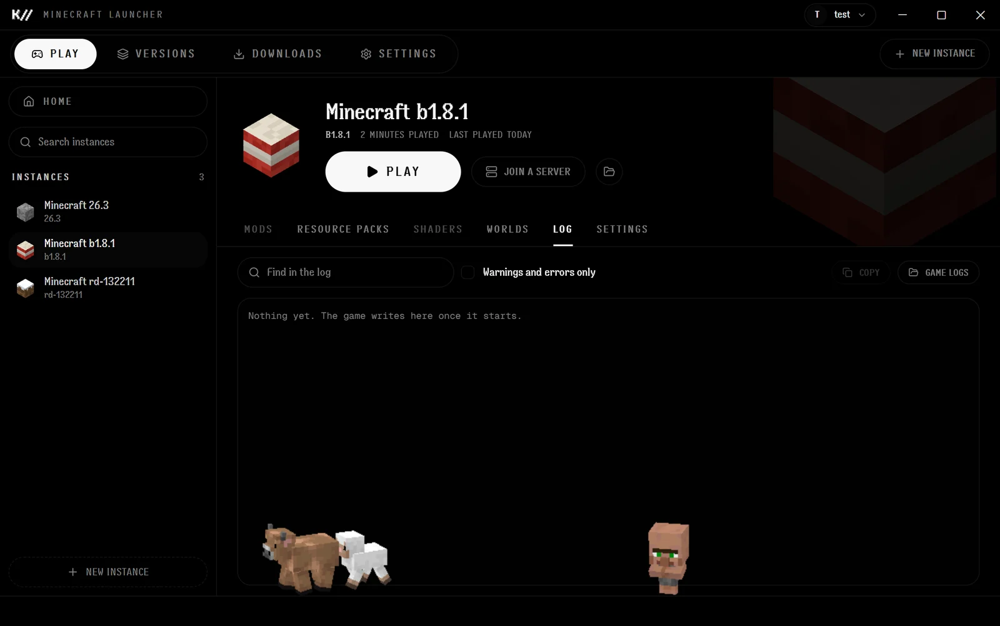
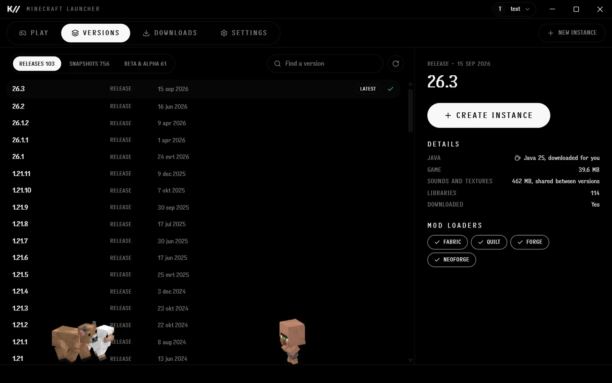
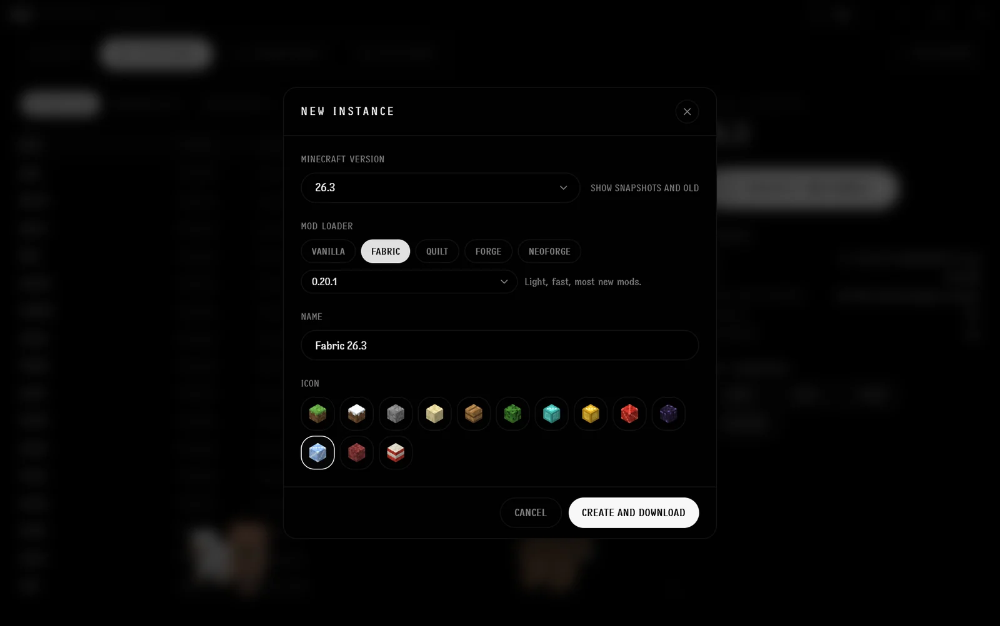
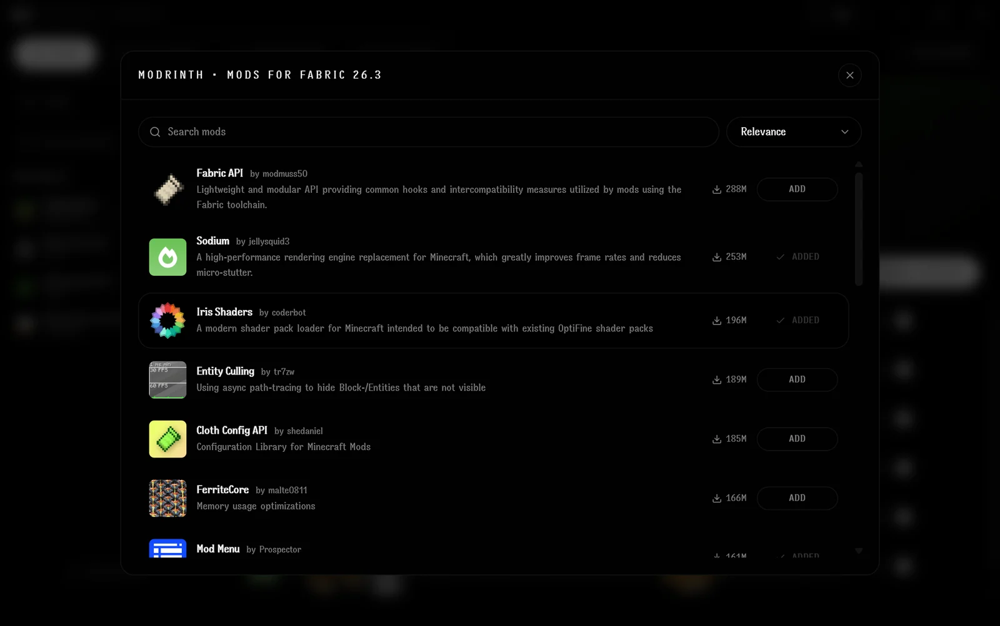
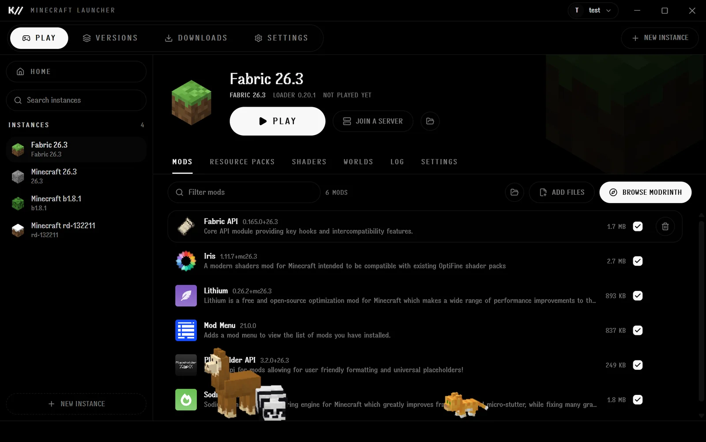
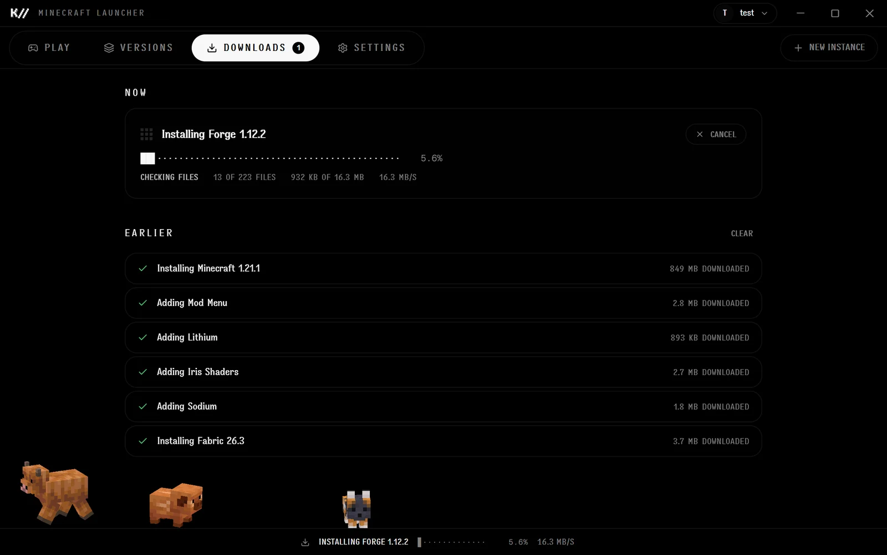
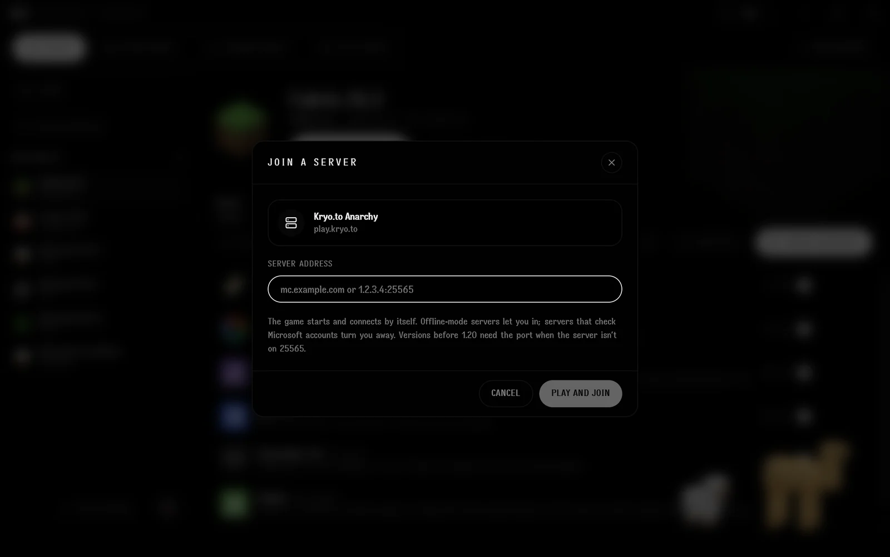
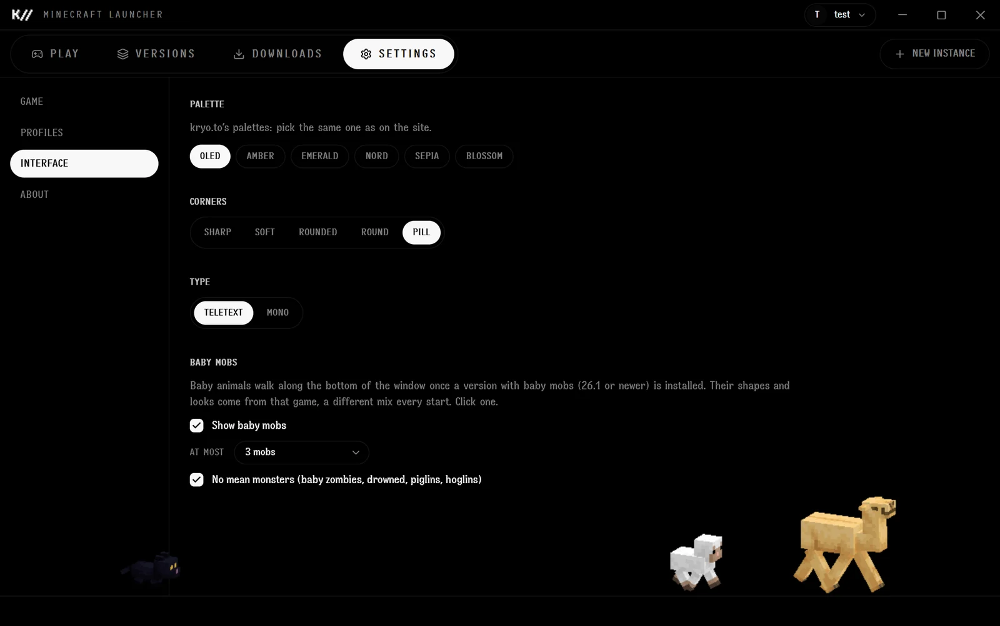

<p align="center"></p>

# Kryoto Minecraft Launcher

Install and play any Minecraft: Java Edition version, from today's release back to the first
alpha, with Fabric, Quilt, Forge or NeoForge, and mods and packs from Modrinth. Pick a name and
play: singleplayer, LAN and offline-mode servers, no account needed. Windows and Linux.

**Kryoto** · Tauri 2 (Rust) + React · MIT · [Download](https://github.com/Kryoto-Dev/kryoto-minecraft-launcher/releases/latest) · [All repos](https://github.com/Kryoto-Dev)

The installer holds no Mojang files. Minecraft and the Java it runs on download from Mojang's
own servers when a player installs a version; loaders come from their makers, mods and packs
from Modrinth.



## What it does

**Every version.** Releases, snapshots, Beta and Alpha, straight from Mojang's list, with the
Java each one needs and the mod loaders it supports.



**Instances with any loader.** Each instance keeps its own worlds, mods, packs and settings.
Pick Vanilla, Fabric, Quilt, Forge or NeoForge and the loader version, and it downloads.



**Mods, resource packs and shaders from Modrinth.** Only what fits the instance's version and
loader is shown; the mods a mod needs come with it. Drop your own files on the window, turn mods
on and off.





**Downloads that skip what's there.** Files already on the PC are never downloaded twice,
failed ones are retried, and everything is checked against Mojang's checksums.



**Play anywhere offline mode lets you.** Pick a name and play singleplayer, LAN or offline-mode
servers. Join a server straight from the launcher; Kryo.to Anarchy is one click.



**Baby mobs.** Chicks, piglets, calves, puppies, foals and more walk along the bottom of the
window in 3D, read from the game you installed. Choose how many, and whether the mean ones come.



## Quick start

Install Node 22+, pnpm 10 and Rust, then:

```bash
pnpm install
pnpm dev               # the UI alone in a browser, on sample data (http://localhost:1425)
pnpm app:dev           # the app
pnpm app:build:local   # an unsigned installer for this PC, copied out of the repo
```

Debug builds keep their data in `to.kryo.minecraft.dev`, beside an installed copy's.

On Linux, building needs the usual Tauri packages:

```bash
sudo apt install libwebkit2gtk-4.1-dev build-essential curl wget file libxdo-dev libssl-dev librsvg2-dev patchelf rpm
```

## Linux

Releases have an AppImage (runs anywhere with glibc 2.35+), a .deb and an .rpm, and all three
update themselves. Data lives in `~/.local/share/to.kryo.minecraft`. Mojang publishes Java for
x86_64 Linux, so nothing needs installing; on ARM Linux pick your own Java in Settings.

The window is drawn by WebKitGTK with its DMA-BUF renderer off and, under Wayland, through
XWayland (the frameless window moves and resizes itself); variables you set yourself win. If
the window stays blank, start it with `KRYOTO_GPU=compatible`.

## Layout

| Path | What's there |
|---|---|
| `crates/kryoto-mc/` | the engine, with no UI: versions, downloads, Java, loaders, mods, profiles, launching |
| `src-tauri/` | the app around it: window, commands, events, file dialogs, updater |
| `src/` | the UI: `library` (instances), `versions`, `downloads`, `settings`, `profiles`, `shell` |
| `src/ui`, `src/lib` (listed in `shared.json`) | copies of Kryoto Desktop's components, kept in step by `pnpm sync:shared` |
| `scripts/` | build, brand art, shared-file sync |
| `docs/` | [development guide](docs/development.md) |

## Checks

```bash
pnpm build                                                          # shared files, typecheck, UI build
cargo test --manifest-path crates/kryoto-mc/Cargo.toml              # engine
cargo clippy --all-targets --manifest-path src-tauri/Cargo.toml -- -D warnings
```

The real thing (downloads Minecraft, opens its window, stops it):
[docs/development.md](docs/development.md#the-real-test).

## Release

Bump the version in `package.json`, `src-tauri/Cargo.toml`, `crates/kryoto-mc/Cargo.toml` and
`src-tauri/tauri.conf.json`, and the crates' entries in `src-tauri/Cargo.lock` and
`crates/kryoto-mc/Cargo.lock` (CI builds with `--locked`), add the `CHANGELOG.md` entry and push
to `main`. The release
workflow builds, signs and publishes `v<version>`; installed copies update themselves.

## License

[MIT](LICENSE). Minecraft is Mojang's; this project is not affiliated with Mojang or Microsoft.
